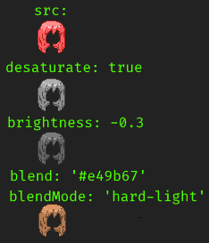
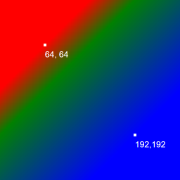
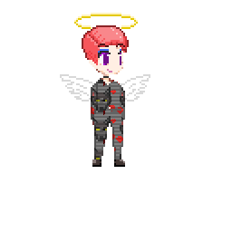

# Canvas renderer

How the game draws layered sprites (the player, NPCs, hair, clothes) onto a canvas. There are two levels:

- **Layers**: draw a list of images by hand. Good for one-off pictures.
- **CanvasModel**: a reusable set of layers that reads an options object. This is what the game uses for characters.

Source: `game/03-JavaScript/00-libs/renderer.js` (layer composition) and `game/03-JavaScript/05-renderer/` (models). The SugarCube widgets are in `game/base-clothing/canvas.twee` (low level) and `game/base-clothing/canvasmodel.twee` (models). A small working model is in `game/04-Variables/canvasmodel-example.js` and `canvasmodel-example.twee`.

## Layers

This draws one processed image.

**JavaScript**

```js
var canvas = Renderer.createCanvas(256, 256);
Renderer.composeLayers(canvas, [
	{
		src: "img/hair/sides/default/chest.png",
		desaturate: true,
		brightness: -0.3,
		blendMode: "hard-light",
		blend: "#e49b67",
	},
]);
```

**SugarCube**

```
<<canvasstart 256 256 1>>
<<canvaslayer 1 "img/hair/sides/default/chest.png" `{ desaturate: true, brightness: -0.3, blendMode: 'hard-light', blend: '#e49b67' }`>>
<<canvasdraw>>
```

Result:



### Processing options

These change how a single image is drawn.

| Option       | Type             | Meaning                                                                                                                                                              |
| ------------ | ---------------- | -------------------------------------------------------------------------------------------------------------------------------------------------------------------- |
| `src`        | string           | Image path. Required.                                                                                                                                                |
| `desaturate` | boolean          | Convert to grayscale first. Default `false`.                                                                                                                         |
| `brightness` | number           | From -1 (black) to +1 (white). Default `0`.                                                                                                                          |
| `contrast`   | number           | `1` leaves it alone, below 1 lowers contrast (`0` is flat gray), above 1 raises it. Default `1`.                                                                     |
| `blend`      | string or object | A CSS colour, a gradient, or a pattern (see [Gradients and patterns](#gradients-and-patterns)). Default none.                                                        |
| `blendMode`  | string           | A canvas [globalCompositeOperation](https://developer.mozilla.org/en-US/docs/Web/API/CanvasRenderingContext2D/globalCompositeOperation) value. Default none.         |
| `masksrc`    | string           | Mask image path. The result alpha is the image alpha times the mask alpha, so anything under a transparent mask pixel is removed. The mask's colour does not matter. |

### Composition options

These control how several layers combine.

| Option            | Type    | Meaning                                                                                                                                          |
| ----------------- | ------- | ------------------------------------------------------------------------------------------------------------------------------------------------ |
| `z`               | number  | Draw order. Higher goes on top. Default `0`.                                                                                                     |
| `name`            | string  | Label for debugging.                                                                                                                             |
| `show`            | boolean | Only the exact value `false` hides the layer. Default `true`.                                                                                    |
| `alpha`           | number  | Opacity from 0 to 1. Default `1`.                                                                                                                |
| `dx`, `dy`        | number  | Offset on the target canvas. Default `0`.                                                                                                        |
| `width`, `height` | number  | Size of one animation frame of this image. Auto-detected by default. Required when this image's frame is smaller than the target canvas's frame. |

Animation options are in [Animations](#animations).

## CanvasModel

A model declares its layers once. Each layer property can be a fixed value or a function of the options (`srcfn`, `zfn`, `showfn`, `animationfn`).

```js
Renderer.CanvasModels["demo_model"] = {
	// ...
	layers: {
		hair_sides: {
			srcfn(options) {
				return "img/hair/sides/" + options.hair_sides_type + "/" + options.hair_sides_length + ".png";
			},
			zfn(options) {
				return options.hair_sides_position === "front" ? ZIndices.hairforwards : ZIndices.backhair;
			},
			showfn(options) {
				return !!options.hair && !!options.hair_sides_type;
			},
			filters: ["hair"],
		},
	},
};
```

Here `filters` is fixed, and `src`, `z` and `show` come from the options. This model reads `hair`, `hair_sides_type`, `hair_sides_length` and `hair_sides_position`.

A layer with no `show` or `showfn` is hidden until a passage turns it on with `<<showlayer NAME>>`.

### Filters

A filter is a layer-properties object applied to every layer that names it in `filters`. Use them to colour many layers at once, such as all hair or one item of clothing. Filters live in `options.filters`.

### Using a model

**JavaScript**

```js
var model = Renderer.locateModel("demo_model");
var options = model.defaultOptions();
options.hair = true;
options.hair_sides_type = "default";
options.hair_sides_position = "front";
options.filters.hair = { desaturate: true, brightness: -0.3, blendMode: "hard-light", blend: "#e49b67" };
var canvas = model.createCanvas();
model.render(canvas, options);
```

**SugarCube**

```
<<selectmodel "demo_model">>
<<set _modeloptions.hair to true>>
<<set _modeloptions.hair_sides_type to "default">>
<<set _modeloptions.hair_sides_position to "front">>
<<modelfilter "hair" `{ desaturate: true, brightness: -0.3, blendMode: 'hard-light', blend: '#e49b67' }`>>
<<rendermodel>>
```

### Hair colours

Known hair colours are in `setup.colours.hair_map`. Use one instead of writing the filter by hand:

```js
options.filters.hair = setup.colours.hair_map["lightbrown"].canvasfilter;
```

Or let the model do the lookup in its `preprocess` function:

```js
Renderer.CanvasModels["demo_model"] = {
	// ...
	preprocess(options) {
		options.filters.hair = setup.colours.hair_map[options.hair_colour].canvasfilter;
	},
};
```

## Animations

There are two ways to animate: a spritesheet animated with CSS, or a JavaScript animation that redraws the canvas every frame.

### CSS animation

Use a layer's `frames` array to choose which sub-sprite each animation frame shows. The array length is the number of frames, and each value is a sub-sprite index. If most layers have a 2-frame idle animation but the eyelids' second frame is "closed eyes" and you want it to stay open, give that layer `frames: [0, 0]`.

Static one-frame images need no setup. They repeat for every frame.

### JavaScript animation

Animations are stored in `Renderer.Animations` (the built-in ones are in `game/03-JavaScript/05-renderer/canvasmodel-animations.js`). A layer names one in its `animation` property, or returns one from `animationfn(options)`.

```js
Renderer.Animations["idle"] = {
	keyframes: [
		{ frame: 0, duration: 1000 },
		{ frame: 1, duration: 1000 },
	],
};
```

When every frame lasts the same time, this shorthand works:

```js
Renderer.Animations["idle"] = { frames: 2, duration: 1000 };
```

Durations are in milliseconds. `frame` is the sub-sprite index.

### Animating layer properties

A keyframe can also change `show`, `alpha`, `blend`, `brightness`, `contrast`, `dx` and `dy`:

```js
Renderer.Animations["idle_redblue"] = {
	keyframes: [
		{ frame: 0, duration: 1000, blend: "#ff0000" },
		{ frame: 1, duration: 1000, blend: "#0000ff" },
	],
};
```

## SugarCube widgets

### Model widgets

| Widget                                                 | What it does                                                                                                                                         |
| ------------------------------------------------------ | ---------------------------------------------------------------------------------------------------------------------------------------------------- |
| `<<selectmodel NAME [INSTANCE]>>`                      | Picks a model and gets it ready. `INSTANCE` is an id used to cache the model between passages. Do not render one instance twice in the same passage. |
| `<<showlayer LAYERNAME [...FILTERS]>>`                 | Shows a layer, optionally adding filters.                                                                                                            |
| `<<hidelayer LAYERNAME>>`                              | Hides a layer.                                                                                                                                       |
| `<<modelfilter FILTERNAME FILTER>>`                    | Sets a filter object. It copies the object, so you can edit your original safely.                                                                    |
| `<<modelfilterset FILTERNAME OPTIONNAME OPTIONVALUE>>` | Sets one option on a filter.                                                                                                                         |
| `<<animatemodel [CSSCLASS]>>`                          | Renders the model and animates it with JavaScript.                                                                                                   |
| `<<rendermodel [CSSCLASS] [CSSANIM]>>`                 | Renders the model as a still image. If `CSSANIM` is true (default false), it renders every frame so CSS can animate it.                              |

### Low-level widgets

| Widget                                      | What it does                                                                               |
| ------------------------------------------- | ------------------------------------------------------------------------------------------ |
| `<<canvasstart WIDTH HEIGHT FRAMES>>`       | Creates an off-screen canvas and an empty layer list. All three arguments must be numbers. |
| `<<canvaslayer Z SRC [OPTIONS...]>>`        | Adds a layer. Extra option objects are merged, and the last one wins.                      |
| `<<canvasanimate [CSS_CLASSES]>>`           | Puts the `<canvas>` here, then renders and animates the layers into it.                    |
| `<<canvasdraw [FRAMECOUNT] [CSS_CLASSES]>>` | Puts the `<canvas>` here and renders the layers into it once.                              |

You can also add a layer from script with `<<run canvaslayer(...z|src|options)>>`. Arguments are sorted by type: a string is `src`, a number is `z`, an object is options. Leftmost arguments win.

## Gradients and patterns

`blend` can be a gradient or a pattern instead of a colour string.

### Gradients

A gradient is an object with:

- `gradient`: `"linear"` or `"radial"`.
- `values`: coordinates in pixels from the canvas's top left. Linear is `[x0, y0, x1, y1]`. Radial is `[x0, y0, r0, x1, y1, r1]`.
- `colors`: the colour stops. Each is either `[offset, color]` (offset from 0 to 1) or a plain colour string. Plain strings get evenly spaced offsets.

```js
T.modeloptions.hair_colour = "custom";
T.modeloptions.filters.hair = {
	blend: {
		gradient: "linear",
		values: [64, 64, 192, 192],
		colors: ["red", [0.25, "green"], "blue"],
		// same as [[0.0, "red"], [0.25, "green"], [1.0, "blue"]]
	},
	blendMode: "hard-light",
	desaturate: true,
};
```

Result:



See MDN for [createLinearGradient](https://developer.mozilla.org/en-US/docs/Web/API/CanvasRenderingContext2D/createLinearGradient), [createRadialGradient](https://developer.mozilla.org/en-US/docs/Web/API/CanvasRenderingContext2D/createRadialGradient) and [addColorStop](https://developer.mozilla.org/en-US/docs/Web/API/CanvasGradient/addColorStop).

### Patterns

A pattern is an image tiled across the layer, applied with the layer's blend mode.

```js
T.modeloptions.worn.upper_colour = "custom";
T.modeloptions.filters.worn_lower_custom = {
	blend: { pattern: "wolfharmony" },
	blendMode: "hard-light",
};
```

Result:



The pattern image here is `img/ui/sym-harmony.png`. Patterns are registered in `game/04-Variables/canvasmodel-patterns-lib.js`, for example `registerImagePattern("wolfharmony", "img/ui/sym-harmony.png")`. The same file shows how to define a procedural pattern that takes parameters.

### Face freckles in image packs

Face variants can provide `img/face/{facestyle}/{facevariant}/freckles.png` and
`img/face/{facestyle}/{facevariant}/blush-freckles/freckles-blush-{1..5}.png` or
`blush-freckles/freckles-blusher.png`. Supplied combined images take priority.
When a combined image is missing, the renderer composes the variant's existing
`blush-{1..5}.png` or `blusher.png` with its freckles. Missing variant freckles
fall back to `img/face/{facestyle}/freckles.png`. If the components are unavailable,
the shared `img/face/{facestyle}/blush-freckles/` image is used instead.
Gentle (`default`) keeps the shared combined artwork unless the pack supplies
variant freckles or a variant combined image. Single-frame freckles repeat across
both blusher frames; fallback results use the ordinary renderer image cache.
