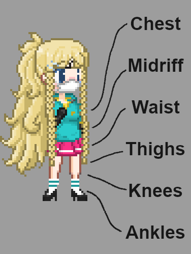

# Combat canvas model notes

Short notes on the combat sprites. For how canvas models work in general, see [README-canvasmodel.md](README-canvasmodel.md).

## Where the code lives

The combat renderer is in `game/03-JavaScript/05-renderer/`:

- `00-combat.js` holds the shared combat state (`CombatSystem`, the clothing states, the positions).
- `20-canvasmodel-combat-*.js` are the close-up models (PC, NPC, swarm, and one per body part: arse, chest, mouth, penis, vagina).
- `22-canvasmodel-combat-xray-*.js` are the x-ray models (arse, penis, vagina).
- `21-*-options.js` and `23-xray-options.js` build the options each model reads.

## Clothing states

Each garment sits in one of these states (`setup.clothingStates` in `00-combat.js`):

`0`, `chest`, `midriff`, `waist`, `thighs`, `knees`, `ankles`, `worn`

`0` means the garment is off. `worn` means it is on normally. The others are how far down (or, for a skirt, up) it has been pushed.

Positions are `doggy`, `missionary`, `wall` and `stalk` (`setup.positions`). Leg positions are `up`, `down` and `footjob` (`setup.legPositions`).

## Lowerwear rules

Most lowerwear can only move along the body: waist, thighs, knees, ankles. Skirts are different because they are tubes. They can be pushed up past the waist, so they also use `chest` and `midriff`.

| Garment     | Required states              | Optional states |
| ----------- | ---------------------------- | --------------- |
| Short skirt | waist, thighs, knees, ankles | chest, midriff  |
| Long skirt  | waist, thighs, knees, ankles | chest, midriff  |
| Trousers    | waist, thighs, knees, ankles | none            |
| Shorts      | waist, thighs, knees, ankles | none            |

Every lowerwear type needs its front and back sprites in all of its states. In missionary the leg position also needs waist, thighs, knees and ankles sprites. Short skirts need the same front and back coverage in doggy.

## Sleeves

Missionary shirts keep their sleeves in a separate `sleeves/` folder next to the body sprites (`img/sex/missionary/clothing/upper/<item>/sleeves/`). The old note about sleeves drawn into the shirt sprites is fixed. Only sleeveless items (rag, tank top, towels, tube top) have no `sleeves/` folder, which is correct.

## Open art problem

The missionary mouth penetrator (`img/sex/missionary/penetrators/human/mouth-entrance`, `mouth-imminent` and `mouth-penetrating`, each with `-condom` and `-sperm` variants) should rest on the PC's face. The earlier note said its base looks too intrusive when other NPC shadows pass over it. That is a judgment about how it looks in game, so it needs an artist to check it in a real scene. The file names in the old note were out of date (`mouth-penetrated.png` is now `mouth-penetrating.png`).
